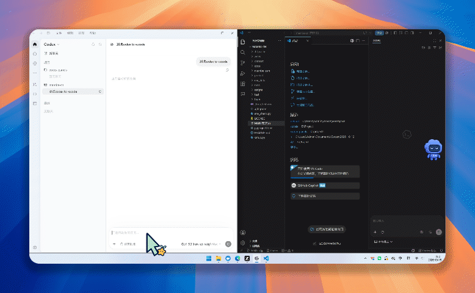

<div align="center">

# codex-panels

**Open-source patches that add terminal & editor panels and bidirectional VS Code session sync to the official Codex desktop app**

`终端 · 编辑器面板 · Codex 桌面端与 VS Code 双向会话同步(Windows)`

[简体中文](README.md) | **English**

[](LICENSE)
[](#)
[](#-quick-start)

Patches and injection code only — no official binaries are distributed.



</div>

---

## ✨ Features

| | Feature | Description |
| --- | --- | --- |
| 🖥️ | **Terminal panel** | Toggle the official terminal from a rail button in Codex's sidebar |
| 📝 | **Editor integration** | One click opens native VS Code with the workspace following the active project; jump back to Codex just as easily |
| 🔄 | **Bidirectional session sync** | Create or continue a conversation on either side, and it shows up on the other within 1–2 seconds |
| 🎯 | **Conversation filter** | Multi-select filter in the official Codex sidebar: current project / other projects / plain conversations |
| 💬 | **AI chat** | Use the official Codex extension or the `@codex` participant in VS Code — models, login and quota all reuse the Codex desktop app (every reasoning-effort level included) |
| 📂 | **Project auto-assignment** | Conversations are automatically assigned to the matching Codex project by directory |

## 🚀 Quick Start

```powershell
git clone https://github.com/Azyai/codex-panels
cd codex-panels
powershell -ExecutionPolicy Bypass -File install.ps1
```

**Requirements**: Windows 10 1809+ · Python 3 · the Microsoft Store version of the Codex desktop app

- The installer copies a writable local copy of the official app and patches it — **the original is never touched**
- Launch via the desktop shortcut **"Codex (panels)"**
- Reload the VS Code window once to pick up the extension
- Uninstall with `powershell -ExecutionPolicy Bypass -File uninstall.ps1` (add `-Purge` to also wipe user data)

> **📄 After an official Codex major update**: just re-run `install.ps1 -Force` (patches locate their targets by content, not offsets).

<details>
<summary><b>🤖 One-liner for any AI agent to install this for you</b></summary>

> Run `git clone https://github.com/Azyai/codex-panels; cd codex-panels; powershell -ExecutionPolicy Bypass -File install.ps1` and follow the prompts.

</details>

## 📁 Project Layout

```
src/
├── desktop/   Code injected into the Codex desktop app (loader / main runtime / page preload / chat bridge)
├── vscode/     VS Code extension (codex-chat: @codex participant, live tree view of conversations)
└── patch/      Patch scripts (asar surgery / binary hash swap / webview polling & filter / CSP allowance)
tools/          Dev & debug tools (CDP testing, protocol probing, asar extraction)
```

## ⚙️ How It Works

The installer copies the official Codex app to a writable location, patches `app.asar` (entry redirected to a loader that chains back to the original), swaps the integrity hash inside ChatGPT.exe, and injects a 1-second list poll into the official extension's webview — the key to bidirectional sync — while also allowing its CSP to fetch filter metadata. **Only patches and injection code are published; no official binaries.**

## ⚠️ Known Limits

- Re-run `install.ps1 -Force` after an official Codex major update
- The patched copy shares user data with the official Codex app — don't run both at once
- This is an unofficial modification; primarily for personal use

## ❓ FAQ

**How do I add an editor / terminal to the Codex desktop app?**
After installing codex-panels, two buttons appear in the official app's left rail: **Terminal** (toggle the built-in terminal panel) and **Open Editor** (launch native VS Code with the workspace following the active project).

**Can Codex sync conversations with VS Code?**
Yes — that's the core feature. Create or continue a conversation on either side and it appears on the other within 1–2 seconds, with models and login fully reusing the Codex desktop app.

**Does it modify the official program?**
No. The installer copies the official app to a writable location and patches only that copy. The original stays untouched, and this repo ships patches only — no official binaries.

**Is it safe?**
Models, login and quota all reuse the official Codex app; no credentials are touched and nothing extra is uploaded. It is an unofficial modification — mainly for personal use.

**What happens after an official Codex update?**
Re-run `install.ps1 -Force` to re-patch the new version; patches locate targets by content, not offsets.

## 📄 License

[MIT](LICENSE) — This repository ships patches and injection code only; OpenAI Codex and related trademarks belong to their respective owners.
